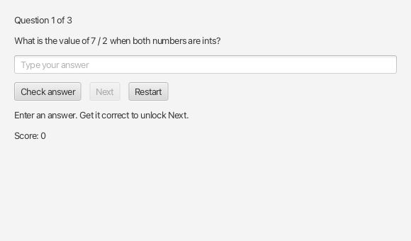

# Study session

Question objects, retries, Next and Restart.

This is a complete editable Zero project.



## Create your own repository and clone it

1. Open [Use this template](https://github.com/codepetca/zero-study-session/generate), then choose **Create a new
   repository**. Select your personal account as owner, choose your own project
   name and follow your teacher's visibility instructions.
2. Open the repository you just created in your own account. Choose **Code →
   HTTPS** and copy its URL. Sign in to Zero and choose **Project → Clone from GitHub…**.
   Paste your URL in **Clone from GitHub**. In **Clone location**, keep the default
   ~/Zero Projects or choose another folder outside any Git repository, then
   choose **Clone here**. Newer VS Code versions open a new window automatically;
   the VS Code 1.95 fallback may ask for **Open in New Window**.

Terminal alternative with your own account and repository name:

```sh
git clone https://github.com/YOUR-USERNAME/YOUR-PROJECT.git
cd YOUR-PROJECT
```

   Replace both placeholders with your own account and repository name. These
   commands work in macOS Terminal and Windows PowerShell with Git installed.
3. The cloned root opens in Zero (the configured VS Code editor). For an
   already-cloned Zero folder, choose **Project → Open local project…** to open
   a new window without cloning again.
4. Choose Run App in the Zero sidebar.

Your own GitHub repository already contains the starter baseline on **main**.
The clone already connects to your own repository as origin.

## ZIP alternative

If you downloaded a ZIP instead, extract it into its own folder and open that
root folder in Zero. A ZIP has no Git history. Create your own empty GitHub
repository, leaving README, license and gitignore uninitialized. Sign in through
Zero and use **Project → Connect to GitHub…** with your own
repository's HTTPS URL, then review **Commit & push** on **main** for the initial
project. Connection alone does not push files.


A supported JDK 17 or later is required. Read and edit the Java files in
`src/main/java`; the Zero framework source is included in its `zero` folder.

From a terminal in this project folder, run:

macOS:

```sh
./mvnw clean compile javafx:run
```

Windows PowerShell:

```powershell
.\mvnw.cmd clean compile javafx:run
```

The pinned Maven wrapper downloads build tools and JavaFX dependencies on the
first run. You can also run `./mvnw clean compile` (or
`.\mvnw.cmd clean compile`) to check your code without opening the app.

## Try one change

Add questions about a subject you choose. Check a wrong answer, a correct answer, the final question and Restart.

## Your GitHub repository and Pika

1. Sign in through the account control in Zero’s sidebar using your personal account.
   Configure Git's per-repository name/email identity manually; signing in does
   not configure commit identity. Real pushes require native GitHub sign-in.
   GitHub actions are live by default; nothing pushes automatically. Check the
   account, repository and branch before submitting a name or commit message.
2. Personalize this README with your project idea and a short change plan.
   If edits are pending, use **Commit & push** on **main** before starting a
   change. Check your repository, branch and changed files, then enter a commit
   message to commit and push.
3. With clean committed main, choose **New branch** in the repository menu and enter its name. Edit the Java, choose **Run App**, and check the behavior you changed.
4. **Commit & push** creates a commit when needed and pushes the current branch.
   Use an explanatory commit message. Review the destination
   and changed files. Commit & push any pending edits before finishing.
5. Click **Merge to main** beside your branch to merge and push the completed change.
   If Zero brings in newer main code, Run App again, then click Merge to main again.
   Merge to main merges the current branch into main and pushes main; it does not create a pull request.
6. Check your actual files on GitHub's **main** branch. Submit your own repository
   link separately in Pika, giving your teacher access if it is private.

Run App does not require GitHub sign-in. Ask your teacher for help with setup,
conflicts or failed pushes. See the [repository and push guide](https://github.com/codepetca/zero/blob/main/docs/GETTING-STARTED.md#your-individual-workflow).

Canonical example source: https://github.com/codepetca/zero-study-session
